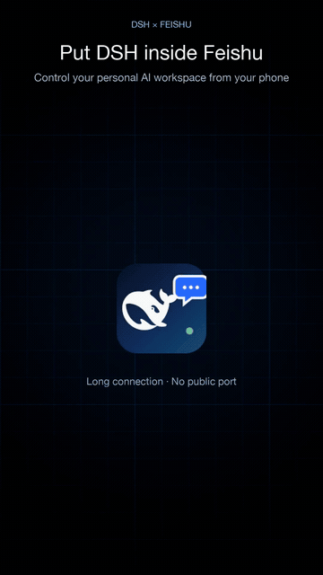

# dsh-feishu-plugin

把飞书接进 [DeepSeek Harness（DSH）](https://github.com/deepseek-ai/deepseek-harness)：**一个飞书话题 = 一个 DSH 会话**，审批、提问、模型与权限切换都在飞书卡片里完成。

## 演示

[](https://cdn.jsdelivr.net/gh/moyuanhua/dsh-feishu-plugin@main/docs/demo/dsh-feishu-promo-9x16-en.mp4)

40 秒竖屏演示（英文旁白）：手机飞书远程操控 DSH 会话、语音输入、图片/文件、权限审批，以及插件配置页。

- [浏览器直接播放（jsDelivr）](https://cdn.jsdelivr.net/gh/moyuanhua/dsh-feishu-plugin@main/docs/demo/dsh-feishu-promo-9x16-en.mp4)
- [MP4 下载](docs/demo/dsh-feishu-promo-9x16-en.mp4)
- [在线播放页](docs/demo/index.html)（在仓库 Settings → Pages 选择 `/docs` 后可通过 GitHub Pages 打开）

这是 Host 插件（Cordis bundle），不是 OpenCode 插件；适配层完全使用 DSH 自己的服务：

| 能力 | 使用的 DSH 服务 |
|---|---|
| 会话创建 / 提示 / 取消 | `sessionController`（`create` / `prompt` / `cancel`） |
| 会话列表 / 标题 / 目录 / 运行状态 | `sessionController.list` + Session projections |
| 模型列表 / 切换 | `sessionController.modelCatalog` / `selectModel` |
| 权限预设 | `permissionPresets.catalog` / `set` |
| 审批 | `approval/request` waterfall（一次性授权） |
| 模型反问 | `user-questions/request` waterfall |
| 流式卡片 | `session/event`、`agent/assistant-stream`、`agent/status` |
| 工作目录 | `workingDirectory.set` |
| 图片 / 文件 | `attachments` / `fileUploads` |
| 凭据 UI | `Config`（volatile + secret）+ `settings` + `plugins.bundle.config` / `plugins.row.config` 客户端页面 |

## 功能状态

- Host 半侧与 Web 配置页在同一个 npm 包里（`lib/index.js` + `lib/client.js`）；
- 发布走仓库原有的 npm Trusted Publishing（OIDC + provenance）流水线；
- 飞书长连接、审批、提问、模型/权限切换、图片/文件均已实现；
- 提问卡支持按钮单选、按钮多选切换，以及表单输入框/话题文字回答；多问题逐题展示；答完最后一题后自动切换到新的运行卡，后续 AI 输出不会写回问题卡上方的旧卡。

## 安装

从 npm 安装（发版后）：

```sh
dsh plugin --profile <profile> add dsh-feishu-plugin
```

本地开发安装：

```sh
dsh plugin --profile <profile> add /path/to/dsh-feishu-plugin
```

发布与版本流程见 [docs/PUBLISHING.md](./docs/PUBLISHING.md)。本仓库沿用
`moyuanhua/dsh-feishu-plugin` 原有的 **npm Trusted Publishing（OIDC + provenance）**
流水线：推 `v*` tag 即发布。

## 飞书后台配置

1. 打开 [飞书开放平台](https://open.feishu.cn/app) → 创建企业自建应用。
2. **添加应用能力 → 机器人**。
3. **权限管理 → API 权限**：
   - `im:message.p2p_msg:readonly`（必开：读取单聊消息）
   - `im:message:send_as_bot`（必开：以机器人身份发消息 / 更新卡片）
   - `im:message:readonly`（接收图片/文件时需要）
4. **事件与回调 → 事件配置**：订阅方式选 **长连接**，添加 `im.message.receive_v1`。
5. **事件与回调 → 回调配置**：订阅方式选 **长连接**，添加 `card.action.trigger`。
6. **版本管理与发布**：创建版本并发布；可用范围建议「仅本人」。
7. 记下 **App ID** 与 **App Secret**。

不申请任何群权限：插件只处理 `p2p` 单聊，机器人物理上收不到群消息。

## 在 DSH 里配置凭据（推荐）

打开 DSH Web GUI → 左侧 **插件** → **已安装插件 → 飞书桥接**：插件详情页会直接显示凭据表单；组件行标题「飞书桥接 ›」也能打开同一配置页。

- **默认工作目录**：输入框 + 「选择目录」按钮（调用 DSH 目录选择器）；
- **默认工作模型**：下拉选择 DSH 当前可用模型；
- **默认工作权限**：下拉选择 DSH 权限预设；
- **App ID**：直接显示当前值，可修改；
- **App Secret**：密文保存，不会回显；留空 = 保持不变，填入新值再保存；
- 点 **保存** 后，Host 会重建飞书客户端并重新建立 WebSocket 长连接；已有会话不受影响。

凭据保存在当前 profile 的 `cordis.patch.yml` 配置覆盖层（DSH 以 `0600` 权限维护），浏览器读取时 Secret 被 Redaction 遮蔽。

也可以直接写 profile 配置（不推荐手改）：

```yaml
- id: feishu
  name: dsh-feishu-plugin
  config:
    appId: cli_xxxxxxxx
    appSecret: xxxxxxxx
```

## 使用方式

### 主聊天流 = 管理台

| 命令 | 作用 |
|---|---|
| `/new [标题]` | 打开建会话表单（目录 / 模型 / 权限预设） |
| `/sessions`（`/ls`） | 会话列表，可翻页、进入话题 |
| `/open <序号>` / `/resume [序号]` | 为选中的会话新开一个飞书话题，并附上会话简介（历史摘要 / 上一条 / 上次回复）；列表卡会变成该会话卡 |
| `/help` | 命令帮助 |

主聊天流只识别 `/` 开头的命令；普通文本一律回管理台卡片，不再做意图识别或自动建会话。

### 话题内 = 一个 DSH 会话

直接发文本即对话；支持图片 / 文件（需 `im:message:readonly`）。

| 命令 | 作用 |
|---|---|
| `/stop` | 取消当前回合 |
| `/current` | 查看当前会话（标题 / 目录 / 模型 / 权限 / 状态） |
| `/brief` | 读取会话简介：历史摘要（如有）、上一条消息、上次回复（读取 Session surface，不恢复 Agent） |
| `/model [关键词]` | 切换到模型；无参数发选择卡片 |
| `/perm [预设名]` | 切换 DSH 权限预设（沙箱 + 审批策略） |
| `/cd <绝对路径>` | 迁移会话工作目录 |
| `/rename <标题>` | 重命名会话 |
| `/steer <文本>` | 立即插队 |
| `/queue <文本>` | 排队 |
| `/cancel` | 清空未提交的临时状态 |
| `/help` | 帮助 |

### 审批

DSH 的审批请求会变成飞书卡片：**允许一次 / 拒绝**。DSH 本身只提供一次性授权，没有「始终允许」；需要长期放行请在 DSH Web 端切换权限预设（例如 Full access）。

### 模型反问

`ask_user_question` 会变成飞书选项卡片；点按钮作答，或直接在话题里回复文字（单选/无选项问题）。多选题请按卡片提示回复选项标签。

## 配置项

`feishu` 行的 `config`：

| 字段 | 默认 | 说明 |
|---|---|---|
| `appId` / `appSecret` | — | 飞书应用凭据；UI 可编辑（volatile + secret） |
| `domain` | `feishu` | `feishu` 或 `lark` |
| `allowUsers` | `[]` | open_id 白名单；空 = 首个发消息者绑定为 owner |
| `allowedRoots` | `[家目录, 当前目录]` | 允许作为会话工作目录的根 |
| `defaultDirectory` | 当前目录 | **新会话默认工作目录**（插件页可「选择目录」，也用于话题内自动建会话） |
| `defaultModel` | DSH 默认 | **新会话默认模型** `{ provider, model }`；插件页下拉选择 |
| `defaultPermissionPreset` | DSH 默认 | **新会话默认权限预设**；插件页下拉选择 |
| `busyDelivery` | `queue` | 忙碌时 `queue` 排队 / `steer` 插队 |
| `stream` | `true` | 是否流式更新卡片 |
| `streamThrottleMs` | `700` | 卡片更新节流 |
| `acceptAttachments` | `true` | 接收图片/文件 |
| `attachmentMaxBytes` | 20MB | 单附件上限 |
| `approvalTtlMs` | 10 分钟 | 审批卡片有效期 |
| `questionTtlMs` | 10 分钟 | 提问卡片有效期 |
| `staleMessageMs` | 120 秒 | 过期消息忽略窗口 |
| `sessionPageSize` | 8 | 会话列表每页条数 |
| `maxAnswerChars` | 12000 | 单卡回答截断 |
| `debugLog` | `false` | **调试日志开关**（插件页可切换）；开 = 强制 `debug` 级别 |
| `logLevel` | `info` | 基础日志级别；`debugLog` 关闭时生效 |
| `logFile` | `~/.dsh/feishu-plugin/feishu.log` | 日志文件；`false` 关闭 |

## 会话简介 / 历史摘要

DSH 没有单独的“会话总结 API”，但持久化日志里有模型可见的完整 surface：

- 话题标题来自 `session/title`；
- 如果这个会话做过 compaction，surface 里会有一条 replace 的摘要消息；
- 上一条用户消息、上次助手回复都在 surface 里。

本插件用 `sessionQuery.readSurface(sessionId)` 读取（冷会话不会恢复 Agent），在进入老会话时：

- 主聊天流里的原会话卡只保留**标题 + 会话 ID**，不再堆消息；
- 话题里的**第一张卡片**展示历史摘要 / 上一条 / 上次回复；
- 也可以随时在话题里发 `/brief` 重新读取。

## 主聊天流意图识别（可选）

`consoleIntent: true` 时，主聊天流的普通文本会先做一次意图识别，再决定：

- `list`：直接出会话列表卡；
- `create`：自动解析标题、目录、模型、权限，直接弹出**预填好的新建表单**（不会直接建会话，用户点提交才生效）；
- `enter`：进入已有会话（新开话题）；标题支持中文重排的模糊匹配，例如“继续飞书插件开发”能匹配到“开发dsh飞书插件”；
- `chat`：无法判断、信息不足或有歧义时**直接回管理台**，不再反问、不做多轮澄清。

用户说“开启/进入/继续会话”时，由模型自己看会话列表决定是新建还是进入哪一个；
一句话内能明确判断就行动，判断不了就回管理台，不追问。
模型调用失败时也回到管理台（或“开启会话”的选择卡），不会自动猜新建。

意图识别和正常会话使用同一个「默认工作模型」（插件页配置的 defaultModel），不单独配置意图模型。

目录规则：优先匹配用户提到的项目/候选目录；没有提就用配置的 `defaultDirectory`；否则在允许根目录下按标题生成新目录；确实判断不了才反问。

命令仍然优先：`/` 开头的命令直接执行，不经过模型。模型不可用、超时（默认 8s）、返回无法解析时：先尝试确定性回退（列表/进入/用默认目录弹出预填表单），仍失败才回退管理台。

```yaml
consoleIntent: true
intentTimeoutMs: 8000
intentHistoryTurns: 8
```

## 话题路由：每次进入新建话题，回答跟随发言话题

与 OpenCode 的恢复逻辑一致：每次从 `/sessions` 或 `/open` 进入会话，都**新建一张 Feishu 话题卡**并绑定到已有 DSH 会话，不查找旧卡片。旧话题仍然有效，可以继续在那里聊。

为避免串话题：

- 每次提问都回复到**用户发消息的那个话题**；
- 每个会话记录「当前活动话题 + 最新锚点消息」，审批卡 / 提问卡 / 状态卡回复到这个锚点；
- 如果会话正在话题 A 处理中，又从话题 B 发消息，会提示「正在另一个话题处理中」，不会把回答写到 A；
- 同一话题的并发第一条消息复用同一个建会话 Promise，不会建出两个会话。

## 流式卡片

运行卡采用**固定骨架**，避免思考很长时卡片来回伸缩：

```text
🤖 处理中
🧠 模型 · 🔐 权限 · ⏱ 12s · 第 1 轮
💭 正在思考… / ✍️ 正在生成回答…
💭 思考过程（抽屉常驻，默认折叠）
🔧 N 次工具调用（抽屉常驻，默认折叠）
────────────
回答正文…
[⏹ 强制停止]
```

- 思考 token 不再逐字写进正文，只每秒刷新一次状态行；
- 思考和工具两个抽屉**始终存在**，即使还没有内容也显示占位，卡片骨架不变；
- 思考抽屉：有内容时默认收起，标题显示「思考中…」；展开可看内容；
- 工具抽屉：不展示单个工具，只显示「N 次工具调用」，展开才看到具体工具；
- 回答开始时不删除抽屉，因此不会突然变矮/变高。

## 工具调用抽屉

运行卡只有一个工具抽屉：

- 卡片里不逐个列工具，只显示「🔧 N 次工具调用」；
- 默认收起，展开后才看到具体工具；
- 只保留最近 12 个工具块，更早的用「已省略前 N 次」提示，避免卡片超过飞书 30KB 限制。

## 与 OpenCode 插件的差异

完整说明见 [docs/adaptation.md](./docs/adaptation.md)。要点：

- **权限**：DSH 只有 `allowed-once` / `rejected`，没有 OpenCode 的 always/session 授权；
- **模型**：DSH 模型目录来自 `llm` / `sessionController`，不再自建 provider 列表；
- **会话**：DSH 的 Session ID、标题、cwd、运行状态来自 Session 投影；
- **开发方案**：DSH Cordis Host 插件 + 同包 Client 模块，不是 OpenCode 的 `Plugin.define`；
- **网关收敛**：DSH 是单 Host 进程，不需要 OpenCode 那种跨 location 的 leader 选举。

## 调试日志

有两种方式打开：

1. **插件页开关（推荐）**：DSH Web → 插件 → 飞书桥接 → 勾选「调试日志」，保存即生效；
2. 配置：`feishu` 行的 `config.debugLog: true`。

然后：

```sh
tail -f ~/.dsh/feishu-plugin/feishu.log
```

debug 级别会额外记录：收到消息的路由（`threadId` / `rootId` / 命中的 `sessionId`）、
卡片操作（kind / messageId / chatId）、会话列表刷新结果、prompt 提交失败的原始错误与 stack。
飞书 SDK 的 `[ws]` 连接日志也走同一文件。

常用排查：

```sh
grep -E '提交消息失败|回合结束|收到卡片操作|会话列表卡片刷新|消息路由' ~/.dsh/feishu-plugin/feishu.log | tail -50
```

## 长连接自愈

飞书 SDK 默认只发 ping、不检查 pong：Wi-Fi 切换、睡眠唤醒、NAT 超时后，TCP 可能仍显示
ESTABLISHED，但飞书事件已经推不过来，也不会触发 close/reconnect，表现就是「机器人突然不说话」。

插件现在：

- 给 `WSClient` 配 `wsConfig.pingTimeout = 30`：ping 后 30 秒没有收到任何入站帧就主动断开并重连；
- 每 60 秒检查 `getConnectionStatus()`，状态 `failed` / `closed` 时重建长连接；
- 每 60 秒写一行心跳：`state` / `inboundCount` / `lastInboundAgoMs` / `reconnectAttempts`；
- 状态变化单独写 `飞书长连接状态变化`；
- `debugLog` 打开时，SDK 的 ping/pong trace 也会进 `feishu.log`。

如果仍出现不回复，先看：

```sh
grep -E '长连接心跳|长连接状态变化|长连接重启|长连接错误' ~/.dsh/feishu-plugin/feishu.log | tail -30
```

## 故障排查

| 现象 | 处理 |
| `飞书长连接心跳` 里 `state=connected` 但 `lastInboundAgoMs` 持续增大 | 典型半开连接；重启插件或等 watchdog 触发重连 |
|---|---|
| 发消息没反应 | 应用是否已发布；事件/回调是否都选长连接；`im:message.p2p_msg:readonly` 是否开通 |
| 日志看哪里 | `~/.dsh/feishu-plugin/feishu.log` |
| 改凭据后不生效 | 在插件页保存后看日志是否出现「飞书凭据已更新，长连接已重启」 |
| 图片/文件收不到 | 开 `im:message:readonly` 并重新发布版本 |
| 审批卡收不到 | 该会话必须是从飞书发起的（有话题映射）；Web 本地会话不接管 |
| 点按钮提示凭证无效 | 审批 token 过期（默认 10 分钟）或操作者不在允许名单 |

## 本地开发

```bash
cd dsh-feishu-plugin
pnpm install
pnpm build      # esbuild 自包含 bundle → lib/index.js + lib/client.js
pnpm test       # node:test
```

配置页 Client 模块（与 Host 同一个包，构建时复制为 `lib/client.js`）：

```bash
node --check client.js
```

本地 tarball 安装/更新：

```text
npm pack
dsh plugin --profile <profile> add ./dsh-feishu-plugin-0.3.4.tgz
```

## 已知限制

- 只处理单聊（p2p），不处理群聊 / 群话题。
- 一个飞书话题只能映射一个 DSH 会话；进入已有会话会新开一个话题。
- 审批只有一次性授权；长期放行依赖 DSH 权限预设。
- 音频 / 视频 / 表情包只显示占位文本。
- 长回答在单张卡片内截断；完整内容看 DSH Web 会话。
